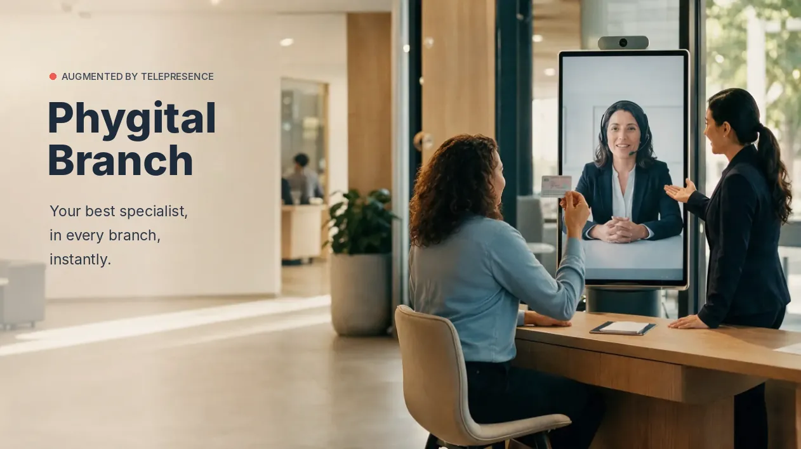

+++
categories = ["industries"]
date = "2026-11-03T09:00:00+02:00"
draft = false
tags = ["telepresencia","phygital","videortc","webacd","banking","cx","ivrpowers"]
title = "The Phygital Branch: Your Best Specialist, in Every Branch, Instantly"
description = "Banking Use Case"
image = "/postimages/industries/phygital-branch-best-specialist.webp"
comments = true
+++

------------
###### Photo source: Interactive Powers

# The Phygital Branch: Your Best Specialist, in Every Branch, Instantly
---

**The best customer experience at every point of service — safer and more efficient across the whole network.**

Face to face, with no appointment, and without having to keep every specialist on staff at every location.

## The customer walks in. The right expert is already there

The customer comes in, and the branch employee welcomes them and connects them with the right advisor: mortgages, investments, insurance, business banking. They are served by the best available expert, instantly.

That's possible because your specialists are no longer spread branch by branch. They work together, ready to serve any customer, at any point in the network.

## An augmented advisor

That advisor works augmented. They have the customer's information and every support system at hand, as if they were sitting in the branch. The request moves forward in the same conversation:

* ✅ No *"come back another day"*.
* ✅ No *"book an appointment"*.
* ✅ No *"call the contact center"*.

## Identification, without breaking the conversation

Identity checks fit naturally into the encounter. The customer shows their ID to the camera, just as they would show it to a person, and it is captured on the spot. No forms, no paperwork, no interruption.

## Triple security control

> The device belongs to the bank. The customer is physically present. And everything is recorded.

* 🔒 **The bank's device.** The camera and the capture system are controlled by the bank, not by the customer's phone. That closes the door to deepfakes and manipulated video.
* 🔒 **Physical presence.** The customer is in the branch, and the employee who welcomes them sees them in person.
* 🔒 **Full record.** The branch security cameras and the recording of the interaction document every operation.

## Your operation wins too

* → One specialist serves several branches, according to demand.
* → Peaks and absences in one branch are covered from anywhere in the network.
* → Your most valuable talent works where it is needed most.

The best experience at every point of service. The best specialists, exactly when your customer needs them. More security, lower costs and more capacity — without growing your structure.

🤔 **How many customers leave your branches today without speaking to the specialist they actually needed?**

---
[Interactive Powers](http://www.ivrpowers.com/) - Streamline your business communications
