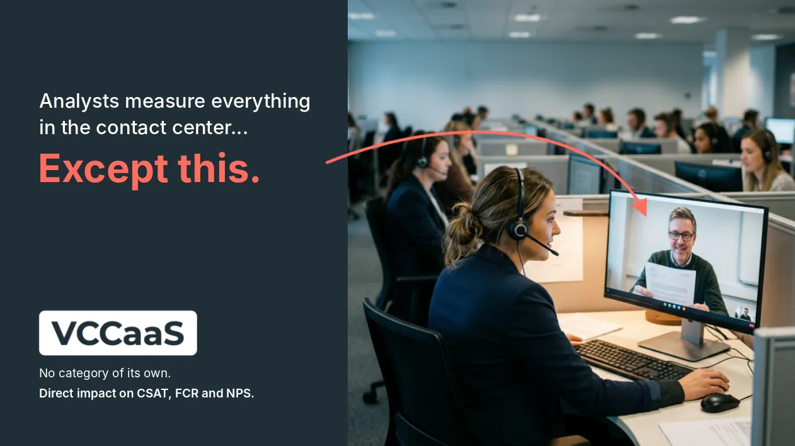

+++
categories = ["trends"]
date = "2026-11-05T09:00:00+02:00"
draft = false
tags = ["vccaas","videocall","contactcenter","ai","cx","ivrpowers"]
title = "Analysts Measure Everything in the Contact Center. Except This"
description = "CX Trends"
image = "/postimages/trends/vccaas-video-layer-contact-center.webp"
comments = true
+++

------------
###### Photo source: Interactive Powers

# Analysts Measure Everything in the Contact Center. Except This
---

Some conversations would be resolved in seconds if the agent could see.

* 🧾 An invoice the customer doesn't understand.
* 📋 A transcription error in an order.
* 📦 A delivery claim.
* ✍🏻 A document before signing.

By phone or chat, those conversations drag on: two people describing in words what a glance would settle.

Contact centers have voice, chat, WhatsApp and even AI. They almost never have a natural way to switch to video at that moment.

## What isn't named isn't asked for

It isn't a lack of technology. It's how the market works.

Contact centers measure what their vendors tell them they have. They buy what those vendors sell them. And what nobody offers them, they don't miss: they assume the conventional is all there is.

What isn't named rarely finds a place, because customers never ask for something they haven't seen, heard or read about. Steve Jobs made the point in 1998, explaining why he didn't design products around what customers asked for: people often don't know what they want until you show it to them.

**And analysts measure what is offered, not what should be.**

That's why customer-service video has no category of its own. It shows up as an API for developers (CPaaS), as a meeting system for employees (UCaaS), or as one more feature of the contact center (CCaaS). Never as a layer of the operation.

## AI is taking voice and text

The shift is already under way, and it's moving fast. Artificial Intelligence (AI) is displacing human agents from voice and text. With video, it can't.

The reason is design. Today's AI is a language model (LLM): it works with text. It analyses conversations, transcripts, documents, code, numbers. When it receives video, it turns it into words and reasons about them.

And in that translation almost everything that matters is lost: the hesitant gesture, the pause in a glance, the document the customer points to with a finger.

An LLM isn't built to process all that information in real time. It would take a different kind of model — a world model (WM) oriented to non-verbal human communication. The ones being researched today are at an early stage, and they learn physics for robots first, not how to understand people's behaviour.

For contact centers, that opens two paths:

* → Whoever keeps selling only voice and text will see their work automated.
* → Whoever adds video will offer exactly what AI can't do.

## VCCaaS: the video layer for the contact center

That's VCCaaS: video as a layer of the contact center you already have. Same queue, same agents, reachable from any channel and with all the context.

> When the agent can see, the customer is resolved first time (FCR), leaves more satisfied (CSAT) and tells others (NPS).

That's where the indicators that matter move.

## When video makes sense

It isn't for everything. Nobody wants video to check a balance. It's for when something has to be seen, an important decision has to be made, or trust has to be built.

🤔 **How many conversations in your operation would be resolved sooner if the agent could see?**

---
[Interactive Powers](http://www.ivrpowers.com/) - Streamline your business communications
