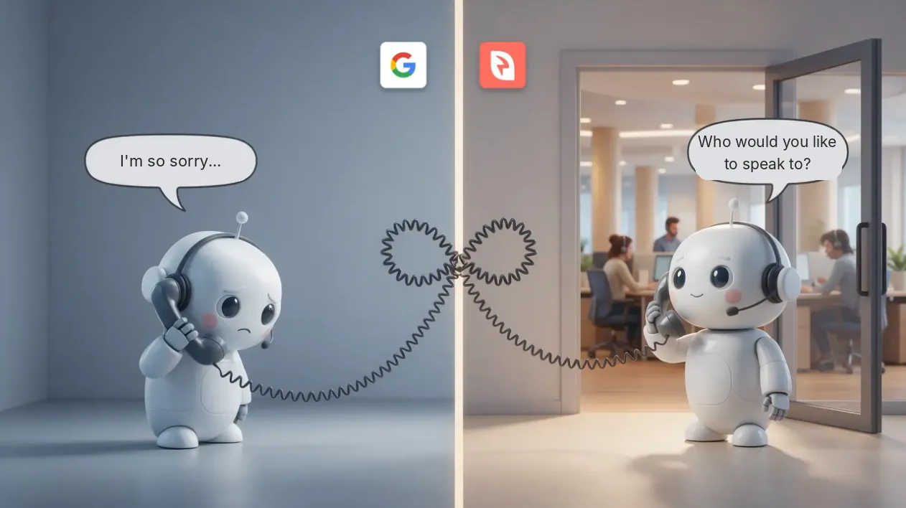

+++
categories = ["trends"]
date = "2026-11-04T09:00:00+02:00"
draft = false
tags = ["custexp","cx","ai","voicebot","smartivr","ivrpowers"]
title = "Asking Without Giving Back"
description = "CX Trends"
image = "/postimages/trends/asking-without-giving-back.webp"
comments = true
+++

------------
###### Photo source: Interactive Powers

# Asking Without Giving Back
---

An automated system from Google Maps called us to confirm whether we were open. Our assistant answered — one designed to get people through to people. One machine asked who it wanted to speak to; the other apologised. In a loop, in several different ways.

We laughed 😂 quite a bit when we saw it. What it reveals is less funny 🤦.

## They want to talk to someone, but put no one on the line

Google asks to speak to a person at your business. It asks for the treatment it doesn't give.

If you're the one who needs to talk to Google, there's no number to call. There are forms. With luck, someone gets back to you — when and through whatever channel they decide.

## We are the source, but not the authority

Nobody knows better than you what time your business opens. Even so, when you change your details, the change goes into review. When their sources or third parties change them, it's published, and it's up to you to correct it.

**Your trust is demanded. Theirs is presumed.**

## The asymmetry of treatment

One side can call, ask, verify, block and correct. The other can only answer — or put up with it — even when asking for the same treatment it is required to give.

> A bare-minimum CX doesn't eliminate the cost: it shifts it onto the customer.

And it only survives through inertia — an inertia that, in the age of AI, no longer has any reason to exist.

## What about you?

More and more queries will be resolved between machines. Whoever still calls you will be someone who genuinely needs something a machine doesn't know how to ask for. And that customer will be key for any business, whatever its size.

The company that doesn't put a person on the other end in those moments will be one bit away from any competitor.

💡 **Asking without giving back has been the norm. Maybe not for much longer.**

---
[Interactive Powers](http://www.ivrpowers.com/) - Streamline your business communications
