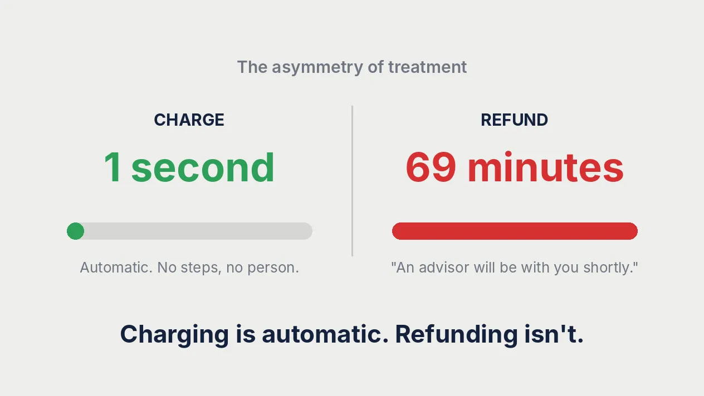

+++
categories = ["trends"]
date = "2026-11-09T16:30:00+02:00"
draft = false
tags = ["automation","ai","customerservice","webacd","cx","ivrpowers"]
title = "Charging Is Automatic. Refunding Isn't."
description = "CX Trends"
image = "/postimages/trends/charging-is-automatic-refunding-isnt.webp"
comments = true
+++

------------
###### Photo source: Interactive Powers

# Charging Is Automatic. Refunding Isn't.
---

**When automation only works in one direction, the customer notices.**

A subscription renews itself for two years. No human involvement, done in a second. The customer didn't want it renewed and asks for it to be reversed.

What happens next isn't unique to any one company. That's why it's worth looking at.

## Automatic to charge, manual to undo

The charge was instant. No steps, no wait, no person.

Undoing it is a different story. The chat assistant understands the request perfectly — but it can't reverse what the system did on its own. Its only option is to hand over to a person.

Automation was built to charge. Not to correct.

## "Transferring you to someone" — but no one is there

Within the same minute, two messages arrive:

*"An advisor will be with you shortly. Thank you for your patience."*
*"Your estimated wait time is 69 minutes."*

Both are true. Together they make no sense.

**Handing over to a person isn't serving the customer. If no one is available, you've just moved them from one queue to another.**

And during that wait there's no alternative: no callback, no appointment. Whoever can't wait an hour and a half simply gives up — and never appears in any complaint statistic.

## They delivered. The problem remains

An hour and a half later, a person picks up the chat and approves the refund. The company delivered, and that's appreciated.

But the problem was never that person. It was everything the customer had to go through to reach them.

## It can be done differently

Large retailers let customers return a physical product in a couple of clicks — with transport and a warehouse involved. A digital renewal doesn't even need logistics.

> When reversing is slower than charging, it isn't a technical limit. It's a priority.

What closing the gap looks like:

* ✅ The same automation that charges can also reverse, within clear rules.
* ✅ When a person is needed, the handover lands on someone available — not in a 69-minute queue.
* ✅ If no one is free, a callback or a booked slot instead of open-ended waiting.

## The asymmetry of treatment

To charge, everything is immediate. To undo, everything is waiting.

The customer doesn't experience it as a systems problem. They experience it as a matter of treatment: the company is in a hurry when it's time to get paid, and asks for patience when it's time to help.

The speed at which you respond says what matters to you.

🤔 **Does your customer get the same treatment when they pay you as when they ask you for help?**

---
[Interactive Powers](http://www.ivrpowers.com/) - Streamline your business communications
