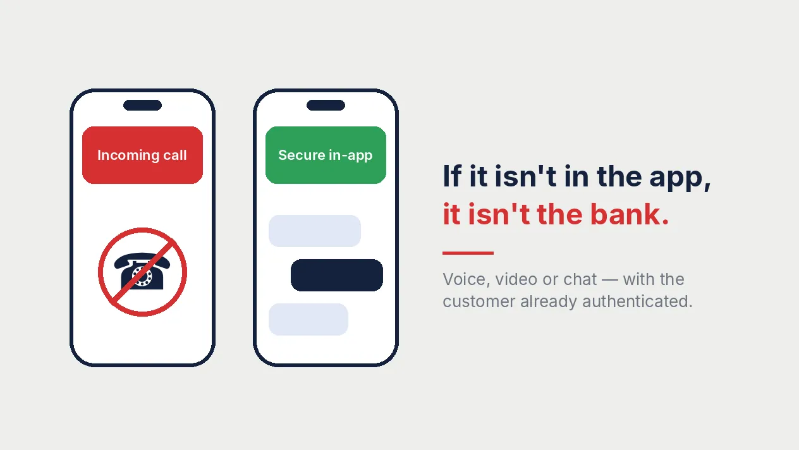

+++
categories = ["trends"]
date = "2026-11-18T16:30:00+02:00"
draft = false
tags = ["fraud","banking","security","webrtc","rtc","cx","ivrpowers"]
title = "Verifying the Phone Call Isn't Enough. Remove It."
description = "CX Trends"
image = "/postimages/trends/verifying-the-call-isnt-enough.webp"
comments = true
+++

------------
###### Photo source: Interactive Powers

# Verifying the Phone Call Isn't Enough. Remove It.
---

Several fintechs and banks have started rolling out **call-status banners**: if a customer is on the phone while their app session is open, the app shows a signal. Green, it's a genuine agent. Amber, hang up.

It's the most sophisticated response the sector has produced so far to phone impersonation. And it's still a crutch: it helps you keep walking, but it doesn't heal the problem. It props up a channel that can no longer stand on its own.

## Verifying means keeping the phone network

On the phone network, the number is declared by whoever is calling. Anyone can display their bank's number, and impersonation attempts keep growing — one fintech industry source reports a **130% rise in a single year in the US**.¹

A banner doesn't close that hole. It leaves it open and puts a guard next to it.

## And it shifts the work to the customer

Faced with an urgent call from "the fraud team", the customer has to remember the banner, open the app without hanging up, check the colour — and recall the list of things the bank will never ask by phone. All under pressure, which is exactly what the fraudster is counting on. And the fraudster only needs someone to forget once.

With cloned voices, that pressure escalates: Deloitte estimates generative-AI-enabled fraud in the US could reach **$40 billion by 2027**.² Blocking transactions during a call slows the fraudster down — and the honest customer too.

## Remove the channel

The alternative is simpler: state publicly **"we will never call you outside the app"** — and keep that promise.

Fraudsters can keep calling, but they'll no longer fool anyone, because any call in the bank's name is fraud by definition. One rule the customer can actually remember:

> If it isn't in the app, it isn't the bank.

The conversation starts in the app, with the customer already authenticated, by voice, video or chat. When the bank needs to talk, it connects from there.

* ✅ The customer is identified before the conversation begins.
* ✅ No caller ID to spoof, no number to fake.
* ✅ No checklist to remember under pressure.
* ✅ The agent sees who they're talking to and the context of the session.

The organisations deploying banners usually already have the hard parts: a good app, strong authentication and a connected contact center. What's missing is the last step — connecting voice and video to the app instead of patching the phone line. Maintaining the crutch can end up costing more than doing it right.

🤔 **Has your organisation decided whether it wants to verify the phone call — or stop needing it?**

*¹ Fintech Global, cited in industry guidance on bank impersonation calls. ² Deloitte Center for Financial Services (2024).*

---
[Interactive Powers](http://www.ivrpowers.com/) - Streamline your business communications
