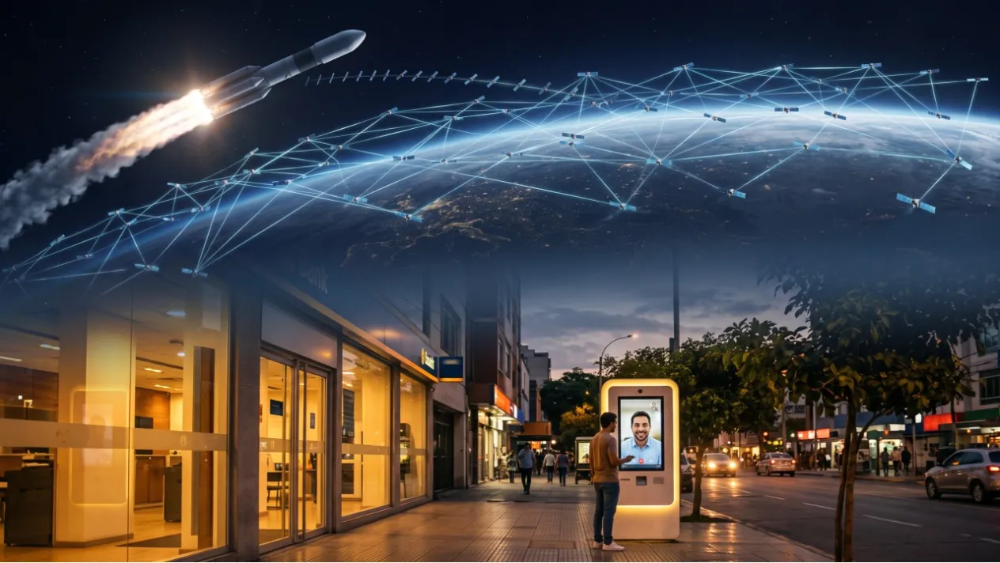

+++
categories = ["trends"]
date = "2026-11-22T16:30:00+02:00"
draft = false
tags = ["telecom","ott","satellite","telepresencia","phygital","ivrpowers"]
title = "When the Internet Runs Through Space, Operators Are Left with Local Services"
description = "Telecom Trends"
image = "/postimages/trends/when-the-internet-runs-through-space.webp"
comments = true
+++

------------
###### Photo source: Interactive Powers

# When the Internet Runs Through Space, Operators Are Left with Local Services
---

According to the published roadmaps of the largest satellite operators, it's a matter of two years or less: **orbital data centers from late 2027 and direct-to-mobile satellite service in 2028.**¹

Meanwhile, almost everything stays the same. Traditional operators keep investing in 5G and 6G as if nothing were about to change. When those plans are executed, the impact on the traditional model will be severe.

## If compute and network are in space…

The ambition isn't only a planetary network. Applications have already been filed to launch up to **one million satellites working as AI data centers**.¹

The reasoning is simple: if compute is in space, and the network connecting it is too, access to the internet runs through there. Whoever controls where data is processed and how it is reached controls access on a planetary scale.

## What's left for the operator

In that scenario, the operator's network stops being the mandatory road to the internet. And nobody pays a toll on a road they no longer need.

**The only thing that can't come from space is what's local: the use and the service.** What happens inside the branch, the clinic or the hotel — and how the customer is served there.

## The only way out: what they never wanted to do

Operators never truly committed to local **OTT (over-the-top)** services — those that run over the network regardless of who operates it. They saw them as a threat, even when they were their own.

Now they're the way out:

* ✅ Managing connectivity inside the customer's premises.
* ✅ Operating the services that run on top of it.
* ✅ Bringing remote video service to every physical point of attention.

> If operators don't do it, someone else will.

👉🏻 **What local value do you offer your customer that a global network can't?**

*¹ Public filings and roadmaps reported by BGR, Android Authority and Light Reading (2026).*

---
[Interactive Powers](http://www.ivrpowers.com/) - Streamline your business communications
